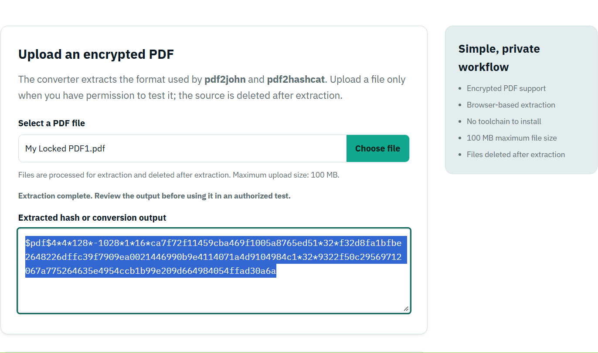
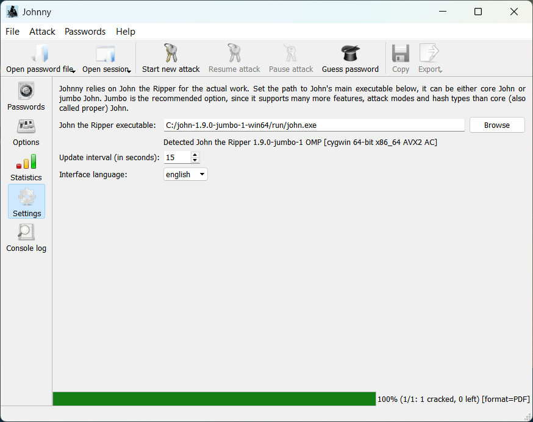
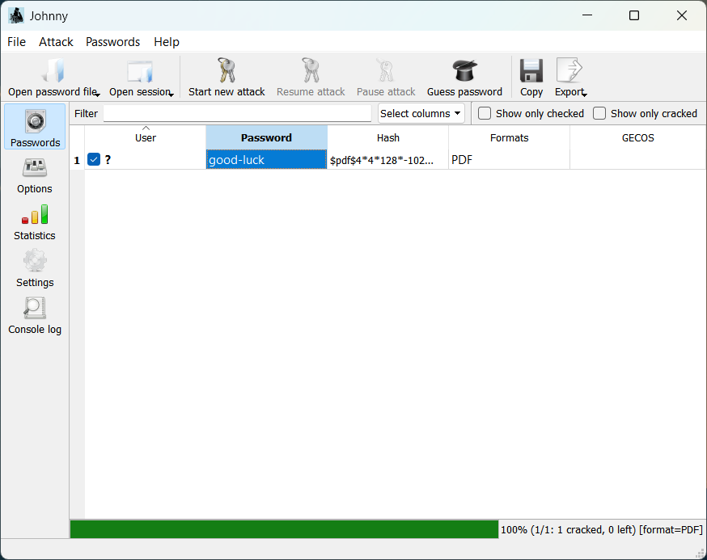
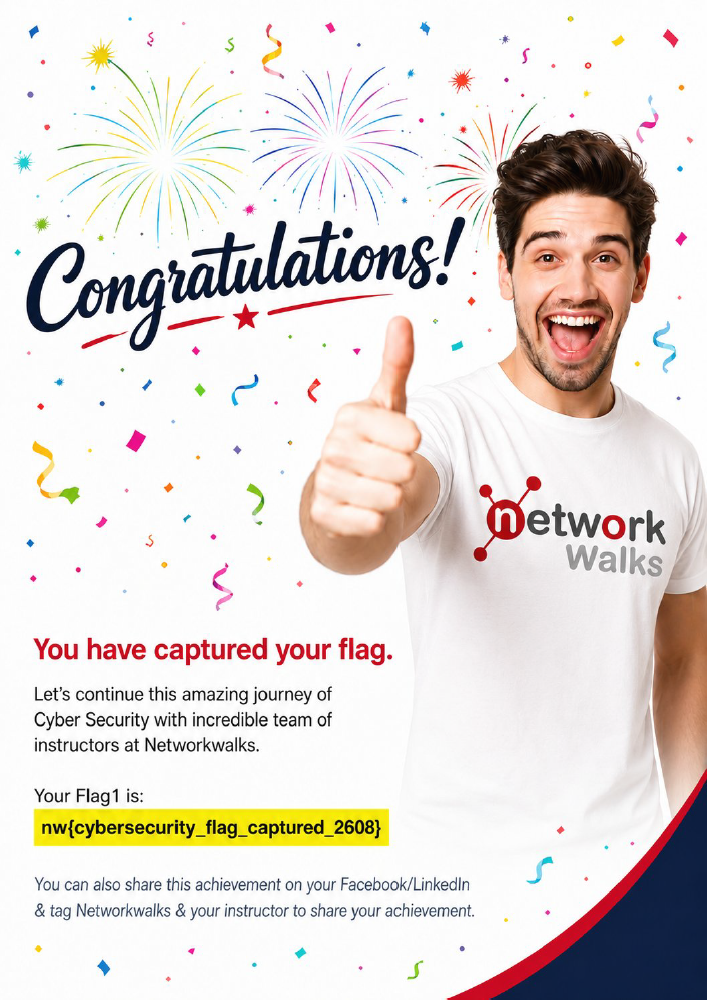
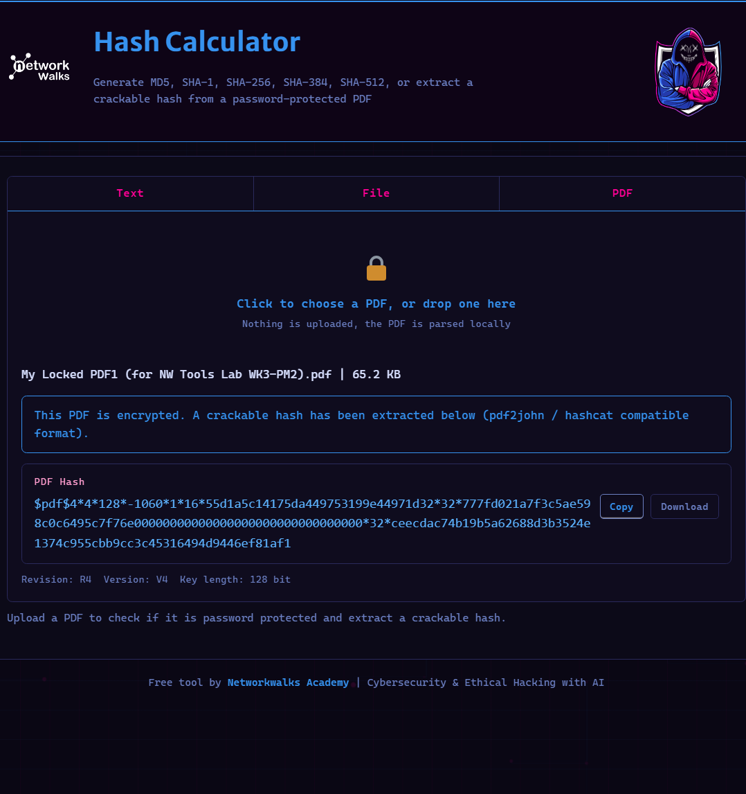
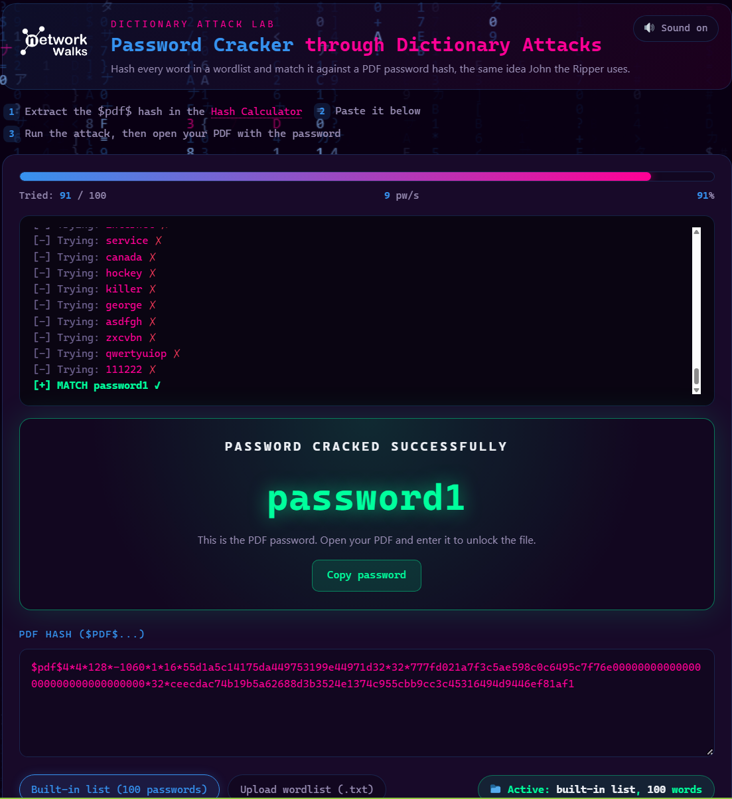

# NETWORKWALKS-IFEANYI-B084-WK3-PM1-PM2-PASSWORD-CRACKING

**Networkwalks Cybersecurity Internship — Batch B084**
**Intern:** Nnani Ifeanyi
**Week 3 — Project Modules 1 & 2 (Essentials)**

This repo covers both required Week 3 modules: recovering the password of a
protected PDF file using two different methods — John the Ripper (JTR) and
the Networkwalks online tools.

---

## WK3-PM1 — Password Cracking with JTR

**Task:** Crack the password of the attached PDF (`My Locked PDF1.pdf`) using
JTR John and JTR Johnny.

**Steps performed:**

**1. Extracted the PDF's password hash** using the Online HashCrack PDF hash
extractor tool (`$pdf$...` format, compatible with `pdf2john`/`pdf2hashcat`),
and saved it into `hash1.txt`.

**2. Opened Johnny** (the JTR GUI) and loaded `hash1.txt` via **Open password
file**, with John's path configured.

**3. Started the attack.** Johnny cracked the password: **`good-luck`**

**4. Confirmed the result** by opening the PDF with the recovered password.

---

## WK3-PM2 — Password Cracking with Networkwalks Tools

**Task:** Crack the password of the attached PDF (`My Locked PDF1.pdf`) using
the Networkwalks Hash Calculator and Password Cracker (browser-based, no
install required).

**Steps performed:**

**1. Uploaded the locked PDF** to the **Networkwalks Hash Calculator** — it
returned the hash starting with `$pdf$...`.

**2. Pasted the hash into the Networkwalks Password Cracker** and ran a
dictionary attack. The tool cracked the password: **`password1`**

**3. Confirmed the result** by opening the PDF with the recovered password.

---

## Demo video

[`WK3-PM1-PM2-demo.mp4`](WK3-PM1-PM2-demo.mp4) — a single captioned walkthrough
covering both modules end to end (hash extraction → cracking → unlocked file),
used for the LinkedIn/YouTube write-up.

---

## Key takeaway

Both labs recover the same class of password (a PDF owner/user password hash)
but through different tool chains — a local GUI cracker (JTR/Johnny) vs. two
purpose-built online tools. Either approach reaches the same result quickly
because the target password was short and dictionary-guessable, which is
exactly the point of the exercise: weak passwords fail fast against both
free, publicly available tools.

---
*Part of the Networkwalks Cybersecurity Internship — Batch B084.*
*Lab files and target PDFs provided by Networkwalks for training purposes only.*
